# ssm乐优购物商城

> 🎓 **计算机毕业设计 · ssm乐优购物商城**
>
> 本仓库只放**项目介绍 + 运行截图**（截图是站点带水印的原图，存在仓库 `images/` 里）。
>
> 👉 **完整可运行源码 / 数据库脚本 / 部署文档：[点我获取](https://geekcode.top/archives/ssm%E4%B9%90%E4%BC%98%E8%B4%AD%E7%89%A9%E5%95%86%E5%9F%8E?utm_source=github)**
>
> 💬 咨询微信：**ir9372**　|　🌐 更多项目：[极客代码 geekcode.top](https://geekcode.top/?utm_source=github)
>
> 📌 项目详情页：<https://geekcode.top/archives/ssm%E4%B9%90%E4%BC%98%E8%B4%AD%E7%89%A9%E5%95%86%E5%9F%8E?utm_source=github>

<table><td width="230" align="center"> <b>扫码加微信 ir9372</b></td><td valign="middle">📦 源码 = 项目介绍 + 全部运行截图 + 数据库 + 部署文档 👉 点上方任意截图，直接跳到 <b>极客代码 geekcode.top</b> 详情页</td></table>

---

<h1>ssm乐优购物商城</h1>
<h2>项目概述</h2>

“ssm乐优购物商城”是一个基于SSM框架与JSP技术构建的Web应用系统。该项目旨在实现一个简易的在线购物管理平台，核心功能涵盖用户管理、商品信息管理、订单处理、购买记录查询及留言反馈等模块。尽管项目元数据显示无独立的前后台路由配置，但根据截图中的页面列表（如<code>allusers</code>、<code>dingdanxinxi</code>、<code>shangpinleibie</code>等），系统实际包含了面向管理员的数据维护界面以及基础的用户交互页面。适用人群主要为小型电商运营人员或作为计算机专业毕业设计的教学演示案例。技术架构采用经典的Java Web三层结构，通过Spring进行业务逻辑控制，MyBatis处理数据持久化，JSP负责前端视图渲染，整体设计侧重于功能的完整性与代码的可读性，适合初学者理解传统Web开发流程。

<h2>技术架构</h2>

本项目采用标准的SSM（Spring + Spring MVC + MyBatis）整合架构，前端视图层使用JSP技术。

<strong>后端架构：</strong>

<ol>
<li><strong>Controller层</strong>：由Spring MVC负责接收HTTP请求，解析参数并调用Service层处理业务逻辑，最后返回ModelAndView或JSP页面路径。</li>
<li><strong>Service层</strong>：由Spring容器管理，封装具体的业务规则，如用户注册验证、订单状态更新、商品库存扣减等事务控制。</li>
<li><strong>DAO层</strong>：由MyBatis框架实现，通过XML映射文件或注解将Java对象与SQL语句绑定，完成对MySQL数据库的增删改查操作。</li>
</ol>

<strong>前端架构：</strong>
前端完全基于JSP动态网页技术，结合HTML/CSS/JavaScript实现页面展示。由于未提及Vue或React等现代前端框架，页面交互主要通过表单提交和URL跳转实现，部分动态内容可能依赖JSTL标签库在服务器端渲染后输出至浏览器。

<strong>核心技术选型理由：</strong>

<ul>
<li><strong>稳定性与成熟度</strong>：SSM框架是Java Web开发的经典组合，生态完善，文档丰富，非常适合毕业设计场景。</li>
<li><strong>易于调试与维护</strong>：分层架构清晰，便于定位问题；JSP技术无需复杂的前端构建工具链，部署简单。</li>
<li><strong>数据一致性</strong>：利用Spring的事务管理器保证订单、库存等关键业务的数据原子性。</li>
</ul>

<strong>数据库设计要点：</strong>
根据截图中的页面名称推断，数据库至少包含以下核心表结构：

<ul>
<li><code>users</code> / <code>allusers</code>：存储用户基本信息（ID、用户名、密码、角色等）。</li>
<li><code>products</code> / <code>spxx</code> / <code>shangpinleibie</code>：存储商品信息及分类信息。</li>
<li><code>orders</code> / <code>dingdanxinxi</code>：存储订单详情（订单号、用户ID、商品ID、状态、时间）。</li>
<li><code>purchase_records</code> / <code>goumaijilu</code>：存储历史购买记录。</li>
<li><code>messages</code> / <code>liuyanban</code> / <code>lyb</code> / <code>pinglun</code>：存储用户留言、评论及反馈信息。</li>
<li><code>favorites</code> / <code>shoucangjilu</code>：存储用户收藏的商品记录。</li>
<li><code>news</code> / <code>xinwentongzhi</code>：存储新闻公告信息。</li>
<li><code>links</code> / <code>youqinglianjie</code>：存储友情链接数据。</li>
</ul>
<h2>功能模块</h2>

虽然项目元数据标记为“无前台/后台”，但依据提供的截图页面列表，系统功能可划分为数据展示与管理维护两大维度。所有页面均表现为列表形式，暗示系统主要提供数据的查看、编辑和管理能力。

<h3>1. 用户与权限管理模块</h3>
<ul>
<li><strong>登录页</strong>：系统入口，用于身份验证。</li>
<li><strong>用户注册页 (<code>yonghuzhuce</code>)</strong>：新用户创建账号的功能页面。</li>
<li><strong>所有用户列表 (<code>allusers</code>)</strong>：展示系统中所有注册用户的信息。</li>
<li><strong>用户编辑页 (<code>allusersupdt</code>)</strong>：允许管理员修改特定用户的详细信息。</li>
</ul>
<h3>2. 商品管理模块</h3>
<ul>
<li><strong>商品信息列表 (<code>spxx</code>, <code>页面-商品信息列表</code>)</strong>：展示所有在售商品的详细资料。</li>
<li><strong>商品类别列表 (<code>shangpinleibie</code>)</strong>：管理商品的分类体系，支持按类别筛选商品。</li>
</ul>
<h3>3. 交易与订单管理模块</h3>
<ul>
<li><strong>订单信息列表 (<code>dingdanxinxi</code>)</strong>：展示所有生成的订单记录，包括订单状态、金额等。</li>
<li><strong>购买记录列表 (<code>goumaijilu</code>)</strong>：追踪用户的历史消费行为和数据统计。</li>
<li><strong>收藏记录列表 (<code>shoucangjilu</code>)</strong>：显示用户收藏的商品条目，反映用户偏好。</li>
</ul>
<h3>4. 互动与资讯管理模块</h3>
<ul>
<li><strong>留言板列表 (<code>liuyanban</code>, <code>lyb</code>)</strong>：展示用户提交的留言信息，支持查看和管理。</li>
<li><strong>评论列表 (<code>pinglun</code>)</strong>：展示用户对商品或内容的评论内容。</li>
<li><strong>新闻通知列表 (<code>xinwentongzhi</code>)</strong>：发布和管理平台公告、促销信息等。</li>
<li><strong>友情链接列表 (<code>youqinglianjie</code>)</strong>：维护外部合作链接资源。</li>
</ul>
<h3>5. 系统管理模块</h3>
<ul>
<li><strong>编辑页面 (<code>页面-编辑 (admin)</code>)</strong>：通用的后台编辑接口，可能用于对上述各模块数据进行CRUD（增删改查）操作的核心管理入口。</li>
</ul>
<h2>用户角色与权限</h2>

基于截图中的页面命名（如<code>admin</code>标识）及常规电商系统设计，推测系统存在两种主要角色：<strong>普通用户</strong>与<strong>管理员</strong>。

<table>
<thead>
<tr>
<th align="left">角色</th>
<th align="left">可访问功能模块</th>
<th align="left">权限描述</th>
</tr>
</thead>
<tbody><tr>
<td align="left"><strong>管理员</strong></td>
<td align="left">登录页、所有用户列表、用户编辑、商品信息列表、商品类别列表、订单信息列表、购买记录列表、收藏记录列表、留言板列表、评论列表、新闻通知列表、友情链接列表、编辑页面(admin)</td>
<td align="left">拥有系统的最高权限。可以查看、新增、修改、删除所有模块的数据。包括管理用户账号、维护商品库、处理订单异常、审核留言与评论、发布新闻公告以及配置友情链接。</td>
</tr>
<tr>
<td align="left"><strong>普通用户</strong></td>
<td align="left">登录页、用户注册、个人信息相关页面（具体可见范围取决于登录后的重定向逻辑，通常仅能查看自己的订单、收藏和留言）</td>
<td align="left">权限受限。主要进行自助服务，包括注册账号、浏览商品（若存在前台展示）、下单购买、收藏商品、发表评论及留言。无法访问其他用户数据或系统配置项。</td>
</tr>
</tbody></table>

<em>注：由于项目未明确区分前后台路由，且截图多为列表页，上述权限分配基于典型SSM电商毕设的逻辑推导。管理员通常通过特定的URL或登录后判断角色进入管理视图。</em>

<h2>项目特色与创新点</h2>
<ol>
<li><strong>经典架构的全栈实践</strong>：完整实现了从Controller到View再到Database的全链路开发，体现了Java Web传统开发模式的规范性，对于理解MVC设计模式具有极高的教学价值。</li>
<li><strong>模块化数据管理</strong>：系统将电商业务拆解为用户、商品、订单、互动等多个独立的数据列表模块，每个模块对应独立的页面和数据结构，降低了耦合度，便于单独维护和扩展。</li>
<li><strong>丰富的数据关联展示</strong>：不仅包含核心的交易数据（订单、商品），还涵盖了社交属性数据（评论、留言、收藏）和内容属性数据（新闻、链接），构建了较为完整的电商数据生态闭环。</li>
<li><strong>轻量级部署</strong>：不依赖复杂的前端构建工具（如Webpack/Vite）和微服务组件，仅需Tomcat和MySQL即可运行，极大简化了开发和部署环境要求，适合快速迭代和演示。</li>
</ol>
<h2>部署环境</h2>

为确保“ssm乐优购物商城”正常运行，需准备以下软件环境：

<ol>
<li><strong>操作系统</strong>：Windows 7/10/11, macOS 或 Linux (CentOS/Ubuntu)。</li>
<li><strong>Java Development Kit (JDK)</strong>：建议版本 JDK 1.8 或以上。需配置环境变量 <code>JAVA_HOME</code> 和 <code>PATH</code>。</li>
<li><strong>Web服务器</strong>：Apache Tomcat 8.5 或 9.0 版本。用于部署WAR包或解压后的Web应用目录。</li>
<li><strong>数据库管理系统</strong>：MySQL 5.7 或 MySQL 8.0。需安装MySQL服务，并导入项目配套的SQL脚本以初始化表结构和基础数据。</li>
<li><strong>开发工具（可选）</strong>：IntelliJ IDEA 或 Eclipse，用于代码编写、调试及Maven/Gradle依赖管理。</li>
<li><strong>浏览器</strong>：Chrome, Firefox, Edge 等主流现代浏览器，用于访问JSP页面。</li>
</ol>

<strong>启动步骤简述：</strong>

<ol>
<li>安装并配置JDK和Tomcat。</li>
<li>安装MySQL，创建数据库，执行SQL脚本导入数据。</li>
<li>修改项目配置文件（如<code>applicationContext.xml</code>或<code>jdbc.properties</code>）中的数据库连接地址、用户名和密码。</li>
<li>将项目打包成WAR文件部署到Tomcat的<code>webapps</code>目录下，或直接通过IDEA配置Tomcat Server运行。</li>
<li>启动Tomcat，在浏览器中访问 <code>http://localhost:8080/项目名/login.jsp</code> 进行测试。</li>
</ol>
<h2>五、技术特性</h2>
<ul>
<li>服务端模板渲染（JSP）</li>
</ul>
<h2>六、功能模块截图</h2>
<h3>前台用户端</h3>
<h4>登录页</h4>

<h4>页面-dingdanxinxi列表</h4>

<a href="https://geekcode.top/archives/ssm%E4%B9%90%E4%BC%98%E8%B4%AD%E7%89%A9%E5%95%86%E5%9F%8E?utm_source=github" title="查看完整源码">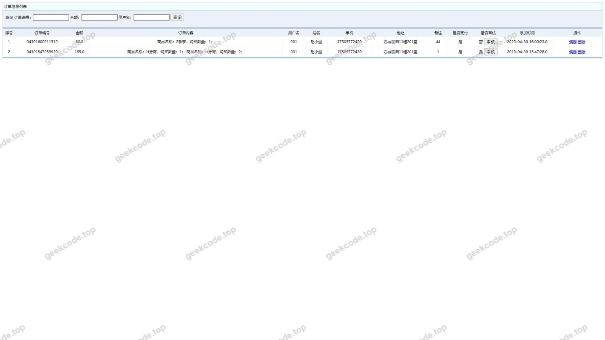</a>

<h4>页面-goumaijilu列表</h4>

<a href="https://geekcode.top/archives/ssm%E4%B9%90%E4%BC%98%E8%B4%AD%E7%89%A9%E5%95%86%E5%9F%8E?utm_source=github" title="查看完整源码">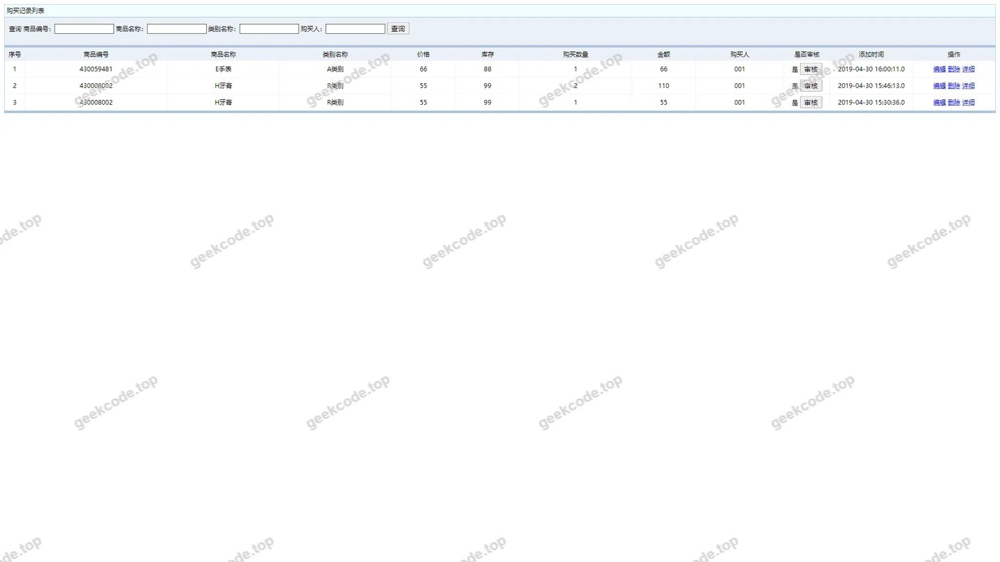</a>

<h4>页面-liuyanban列表</h4>

<a href="https://geekcode.top/archives/ssm%E4%B9%90%E4%BC%98%E8%B4%AD%E7%89%A9%E5%95%86%E5%9F%8E?utm_source=github" title="查看完整源码">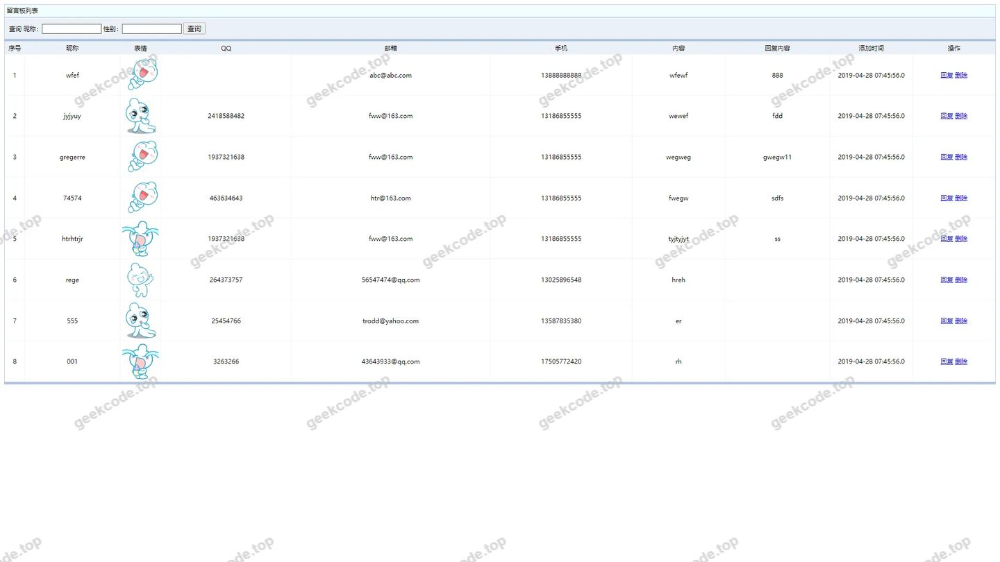</a>

<h4>页面-lyb列表</h4>

<a href="https://geekcode.top/archives/ssm%E4%B9%90%E4%BC%98%E8%B4%AD%E7%89%A9%E5%95%86%E5%9F%8E?utm_source=github" title="查看完整源码">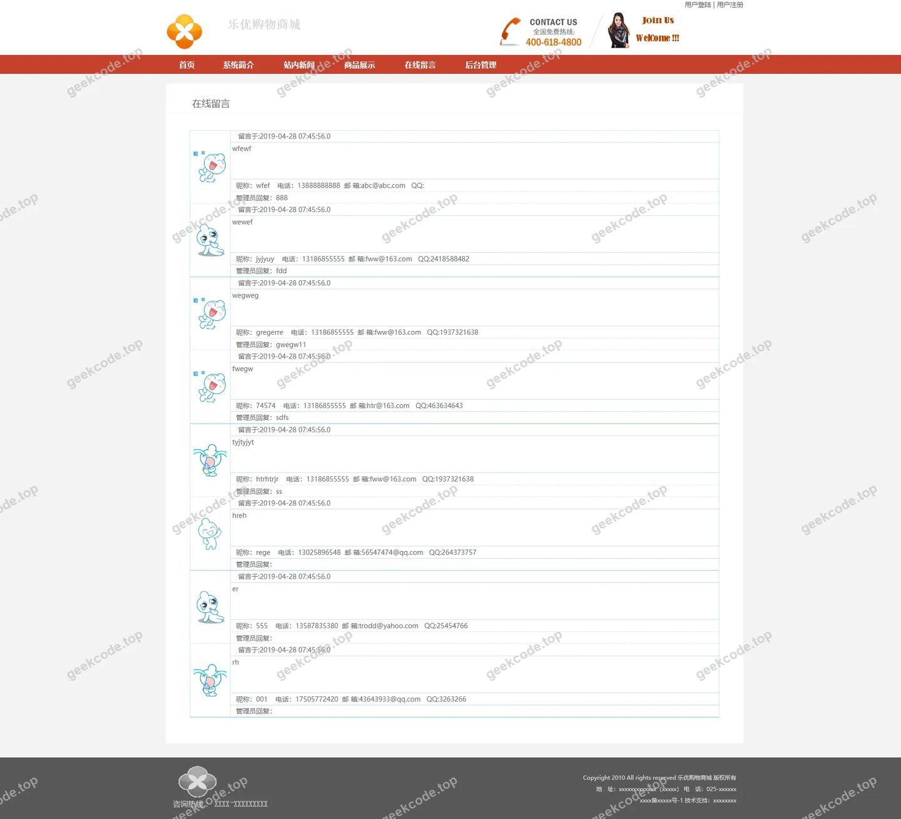</a>

<h4>页面-pinglun列表</h4>

<a href="https://geekcode.top/archives/ssm%E4%B9%90%E4%BC%98%E8%B4%AD%E7%89%A9%E5%95%86%E5%9F%8E?utm_source=github" title="查看完整源码">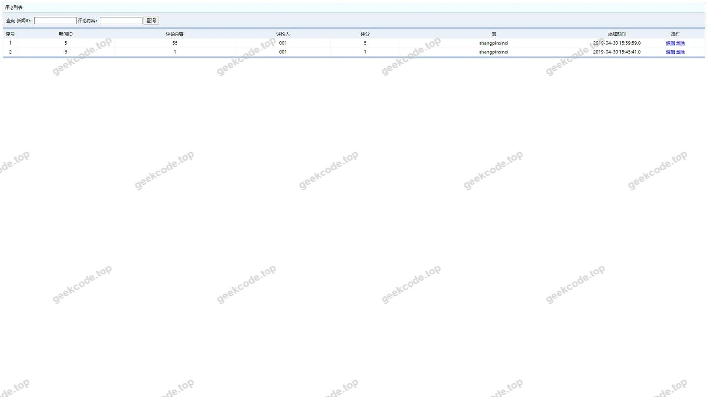</a>

<h4>页面-shangpinleibie列表</h4>

<a href="https://geekcode.top/archives/ssm%E4%B9%90%E4%BC%98%E8%B4%AD%E7%89%A9%E5%95%86%E5%9F%8E?utm_source=github" title="查看完整源码">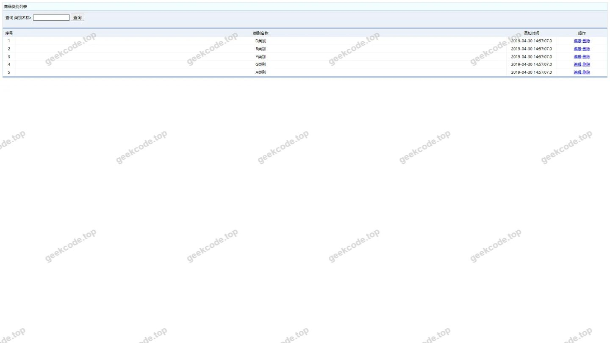</a>

<h4>页面-商品信息列表</h4>

<a href="https://geekcode.top/archives/ssm%E4%B9%90%E4%BC%98%E8%B4%AD%E7%89%A9%E5%95%86%E5%9F%8E?utm_source=github" title="查看完整源码">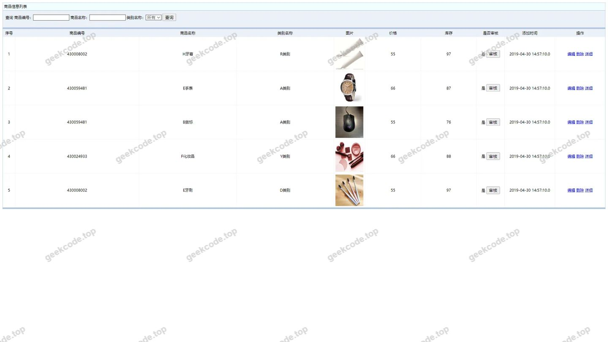</a>

<h4>页面-spxx列表</h4>

<a href="https://geekcode.top/archives/ssm%E4%B9%90%E4%BC%98%E8%B4%AD%E7%89%A9%E5%95%86%E5%9F%8E?utm_source=github" title="查看完整源码">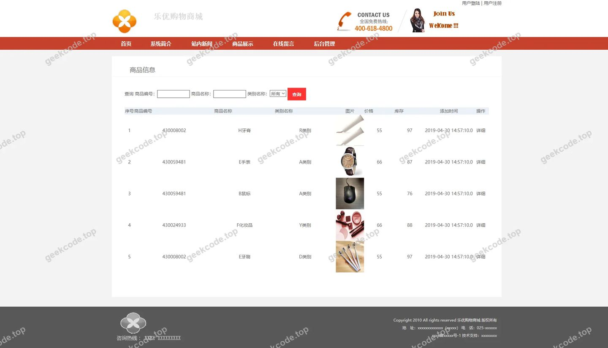</a>

<h4>页面-shoucangjilu列表</h4>

<a href="https://geekcode.top/archives/ssm%E4%B9%90%E4%BC%98%E8%B4%AD%E7%89%A9%E5%95%86%E5%9F%8E?utm_source=github" title="查看完整源码">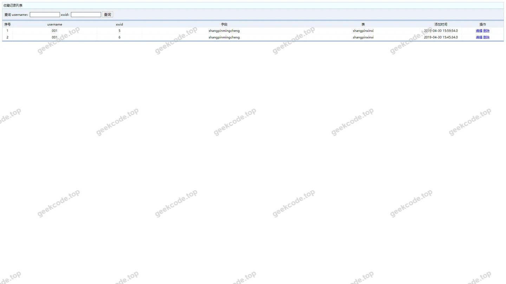</a>

<h4>页面-xinwentongzhi列表</h4>

<a href="https://geekcode.top/archives/ssm%E4%B9%90%E4%BC%98%E8%B4%AD%E7%89%A9%E5%95%86%E5%9F%8E?utm_source=github" title="查看完整源码">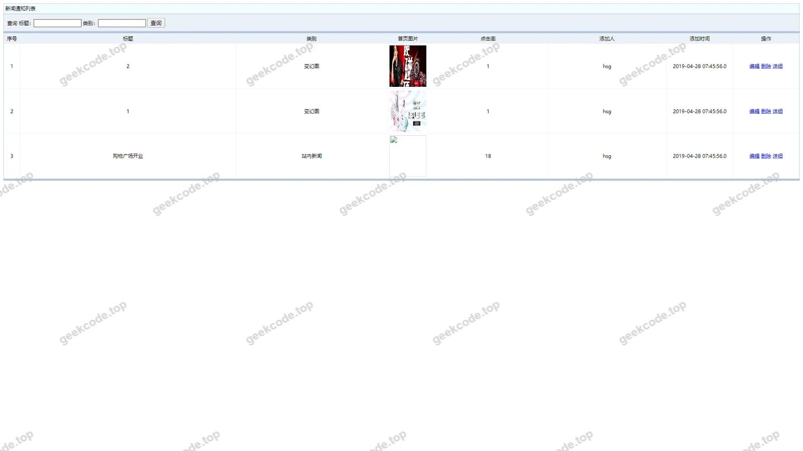</a>

<h4>页面-yonghuzhuce列表</h4>

<a href="https://geekcode.top/archives/ssm%E4%B9%90%E4%BC%98%E8%B4%AD%E7%89%A9%E5%95%86%E5%9F%8E?utm_source=github" title="查看完整源码">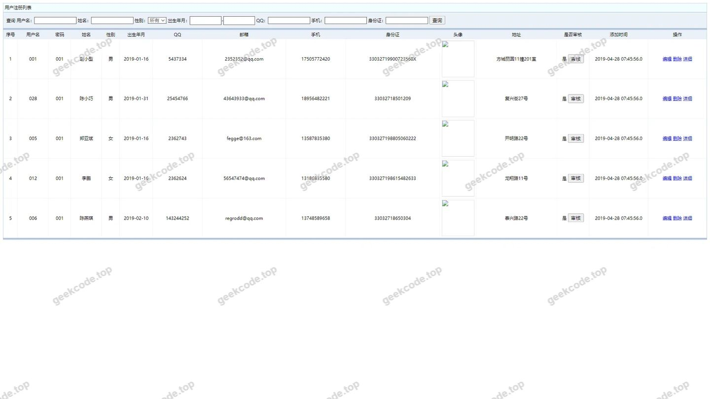</a>

<h4>页面-youqinglianjie列表</h4>

<a href="https://geekcode.top/archives/ssm%E4%B9%90%E4%BC%98%E8%B4%AD%E7%89%A9%E5%95%86%E5%9F%8E?utm_source=github" title="查看完整源码">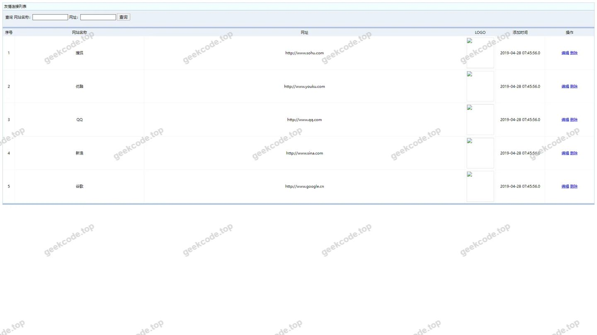</a>

<h4>页面-allusersupdt</h4>

<h4>页面-编辑</h4>

<h3>后台管理端</h3>
<h4>页面-allusers列表</h4>

<a href="https://geekcode.top/archives/ssm%E4%B9%90%E4%BC%98%E8%B4%AD%E7%89%A9%E5%95%86%E5%9F%8E?utm_source=github" title="查看完整源码">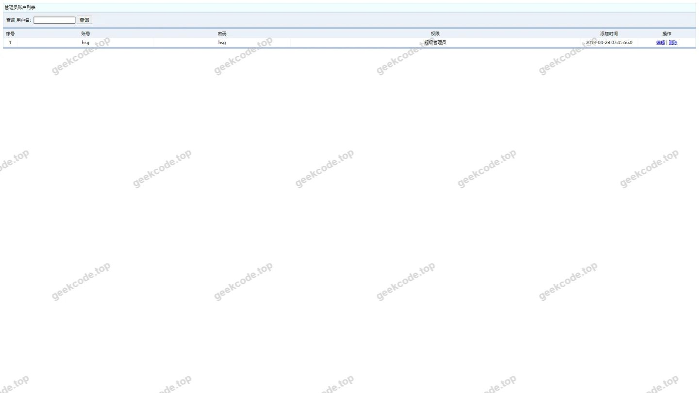</a>

---

## 获取完整源码

| 项目 | 说明 |
| --- | --- |
| 项目名 | ssm乐优购物商城 |
| 运行截图 | 本文 16 张（站点带水印原图，仓库 `images/` 目录） |
| 完整源码 | [https://geekcode.top/archives/ssm%E4%B9%90%E4%BC%98%E8%B4%AD%E7%89%A9%E5%95%86%E5%9F%8E?utm_source=github](https://geekcode.top/archives/ssm%E4%B9%90%E4%BC%98%E8%B4%AD%E7%89%A9%E5%95%86%E5%9F%8E?utm_source=github) |
| 咨询微信 | **ir9372**（备注：jingpin-yuanma） |
| 更多项目 | [极客代码 geekcode.top](https://geekcode.top/?utm_source=github) |

> 需要源码、部署、改配置、跑不起来等问题，加微信 ir9372 沟通，说明项目名即可。
